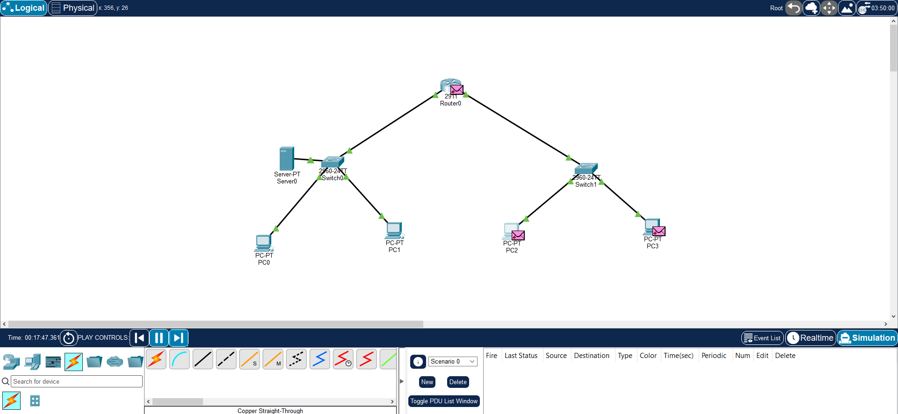
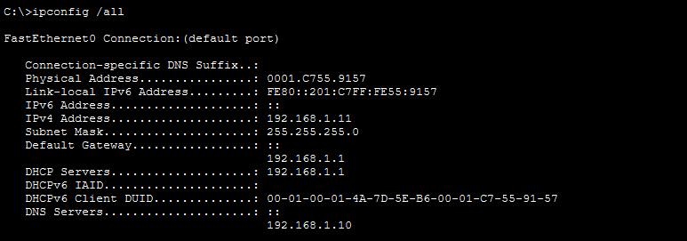
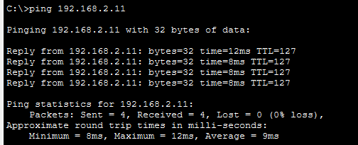

# 🌐 Projet 1 : Simulation de réseau d'entreprise

Ce projet simule l'infrastructure réseau d'une petite entreprise. Il a été réalisé sur **Cisco Packet Tracer (v9.0.1)** dans le cadre de mon apprentissage des réseaux et de l'infrastructure.

## 🎯 Objectifs du projet
* Créer une topologie avec 1 routeur, 2 switchs et 4 PC.
* Configurer le routage entre deux sous-réseaux (LAN1 et LAN2).
* Mettre en place un serveur DHCP pour distribuer les adresses IP automatiquement.
* Configurer un serveur DNS pour la résolution de noms (`www.entreprise.local`).

## 🗺️ Topologie du réseau

## ⚙️ Détails de la configuration
* **Réseau 1 (Gauche) :** `192.168.1.0/24` (Passerelle : `192.168.1.1`)
* **Réseau 2 (Droite) :** `192.168.2.0/24` (Passerelle : `192.168.2.1`)
* **Serveur DNS :** `192.168.1.10` (Adresse IP statique)

## 🧪 Tests et Validations (Preuves)

**1. Le DHCP fonctionne (Les PC reçoivent une adresse automatiquement)**

**2. Le Routage fonctionne (Le PC de gauche ping le PC de droite)**

**3. Le DNS fonctionne (Le nom de domaine est traduit en IP)**

## 🚀 Comment tester ?
1. Téléchargez le fichier `.pkt` présent dans ce dépôt.
2. Ouvrez-le dans Cisco Packet Tracer.
3. Attendez que les voyants des câbles deviennent verts.
4. Ouvrez l'invite de commande d'un PC et testez les pings !
